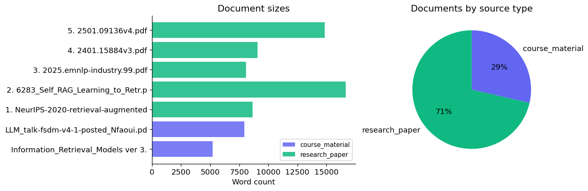
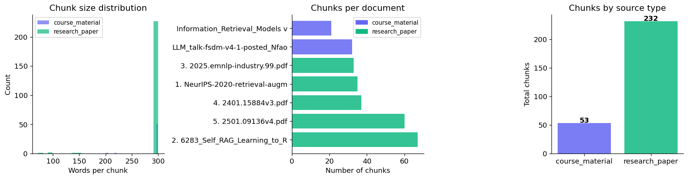
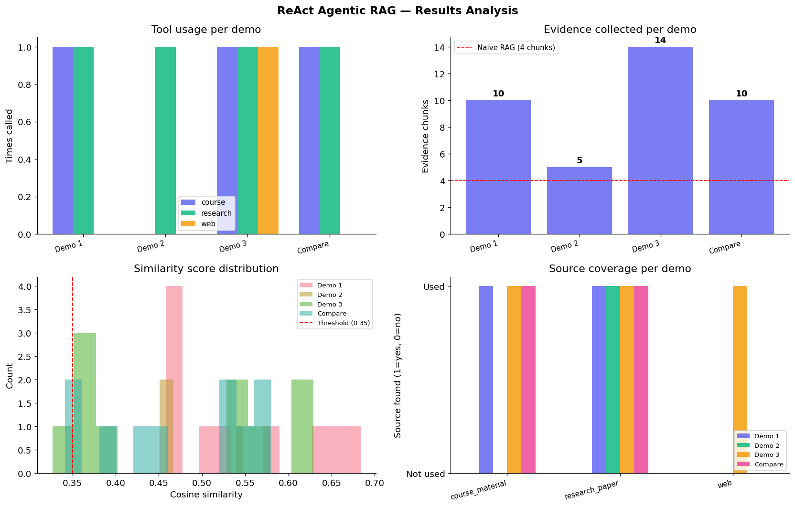

# Multi-Source Agentic RAG

**A ReAct-inspired Retrieval-Augmented Generation system integrating semantic search, multi-source retrieval, evidence evaluation, and LLM-powered answer generation.**

**Academic Project | Al Akhawayn University | MSc Big Data Analytics**

## Overview

This project explores how Retrieval-Augmented Generation (RAG) can be enhanced through multi-source information retrieval and adaptive decision-making.

Unlike a conventional single-pass RAG pipeline, the proposed system combines document retrieval, web search, evidence evaluation, and iterative retrieval strategies to support more comprehensive, context-aware responses.

The system was developed as a collaborative graduate project in Web and Text Mining.

## Key Features

- **Multi-Source Retrieval:** Integrates course materials, academic research papers, and web search.
- **Semantic Search:** Uses SentenceTransformers and FAISS for embedding-based document retrieval.
- **Document Processing:** Extracts, cleans, and chunks textual content for efficient indexing.
- **Adaptive Retrieval:** Implements ReAct-inspired tool planning and evidence evaluation to guide retrieval.
- **LLM Integration:** Supports answer generation using an OpenRouter-hosted language model.
- **Comparative Analysis:** Explores differences between traditional RAG and the proposed multi-source approach.
- **Visualization:** Includes exploratory data analysis and results visualization.

## System Architecture

The system follows a modular pipeline:

```text
                  User Query
                      |
                      v
             Query Processing
                      |
                      v
          ReAct-Inspired Planning
                      |
          +-----------+-----------+
          |           |           |
          v           v           v
     Course       Research      Web
    Materials      Papers      Search
          |           |           |
          v           v           v
       FAISS        FAISS       Tavily
      Retrieval    Retrieval    Search
          |           |           |
          +-----------+-----------+
                      |
                      v
             Evidence Evaluation
                      |
              +-------+-------+
              |               |
        Sufficient       Insufficient
              |               |
              v               v
        LLM Answer       Refine Retrieval
        Generation             |
              |               |
              v               |
         Final Answer <-------+
```

The retrieval workflow uses semantic search and rule-based planning to coordinate information sources. LLM integration supports answer generation rather than fully autonomous control of every retrieval decision.

## Technologies Used

| Technology | Purpose |
|---|---|
| Python | Core implementation |
| SentenceTransformers | Text embeddings |
| FAISS | Vector indexing and semantic retrieval |
| PyPDF2 | PDF text extraction |
| Tavily | Web search integration |
| OpenRouter | LLM API integration |
| NumPy and pandas | Data processing and analysis |
| Matplotlib | Data visualization |
| Jupyter Notebook | Development and experimentation |

## Repository Structure

```text
Multi-Source-Agentic-RAG/
|
|-- README.md
|-- MultiSourceReActAgenticRAG.ipynb
|-- requirements.txt
|-- .gitignore
|
|-- assets/
    |-- eda_chunks.png
    |-- eda_documents.png
    |-- results_analysis.png
```

## Installation and Setup

### 1. Clone the repository

```bash
git clone https://github.com/Khaoula-Alaoui/Multi-Source-Agentic-RAG.git
cd Multi-Source-Agentic-RAG
```

### 2. Install dependencies

```bash
pip install -r requirements.txt
```

### 3. Configure API keys

The project uses OpenRouter for LLM access and Tavily for web search.

Configure the following environment variables before running the notebook:

```text
OPENROUTER_API_KEY
TAVILY_API_KEY
```

API credentials are not included in the repository and should never be committed to version control.

### 4. Run the notebook

Open `MultiSourceReActAgenticRAG.ipynb` in Jupyter Notebook, JupyterLab, VS Code, or Google Colab.

Execute the cells sequentially.

Some functionality requires valid API credentials, internet access, and the appropriate source documents. Consult the notebook for data-loading and fallback behavior.

## Exploratory Data Analysis

The project includes visualizations exploring the document collection and text chunks used for retrieval.

### Document Analysis



### Chunk Analysis



## Evaluation and Results

The project investigates the behavior of a multi-source retrieval workflow and compares it with a traditional RAG baseline.

The analysis focuses on:

- Retrieval from heterogeneous information sources.
- Adaptive tool selection and evidence evaluation.
- Retrieval refinement for complex queries.
- Differences between conventional and multi-source RAG workflows.

### Results Visualization



The results illustrate the behavior observed in the implemented experiments. They should not be interpreted as evidence of general performance superiority without additional controlled evaluation.

## Limitations and Future Improvements

The current implementation is an academic prototype rather than a production-ready application.

Potential improvements include:

- Fully LLM-driven tool orchestration.
- Hybrid retrieval combining BM25 and dense embeddings.
- Persistent vector storage and index management.
- Formal evaluation using RAG-specific metrics.
- Improved source ranking and citation verification.
- Automated testing and deployment.
- Enhanced monitoring, scalability, and error handling.

## Contributors

Developed collaboratively by:

- **Khawla Chrifi Alaoui** — MSc Big Data Analytics, Al Akhawayn University
- **Mohammed Amine Rourrou** — MSc Big Data Analytics, Al Akhawayn University

This repository presents collaborative academic work, with both contributors acknowledged.

## Academic References

1. Yao et al. (2023). [ReAct: Synergizing Reasoning and Acting in Language Models](https://arxiv.org/abs/2210.03629).
2. Lewis et al. (2020). [Retrieval-Augmented Generation for Knowledge-Intensive NLP Tasks](https://arxiv.org/abs/2005.11401).
3. Asai et al. (2023). [Self-RAG: Learning to Retrieve, Generate, and Critique through Self-Reflection](https://arxiv.org/abs/2310.11511).

---

**Project Type:** Graduate Academic Project  
**Institution:** Al Akhawayn University, Ifrane, Morocco  
**Field:** Natural Language Processing, Information Retrieval, Generative AI
